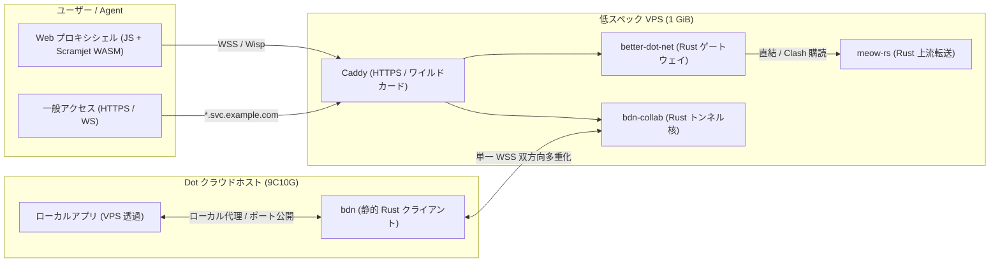

# Better Dot Net

[English](README.md) · [简体中文](README.zh-CN.md) · **日本語**

**低スペックな Oracle AMD 小型 VPS（メモリ 1 GiB）1 台で軽快動作・コア常駐わずか約 13 MiB** —— 次の 2 つの課題を解決します：

1. **AI エージェントのクラウドブラウザからプロキシ経由で Web サイトへ自由にアクセスできるようにする**（Basic）
2. **Dot クラウドホストから外部通信および公衆サービス公開を行えるようにする（開発継続中）**（Advanced）

> Basic サーバー・Advanced サーバー・静的 Agent クライアントは完全分離され、[GitHub Releases](../../releases) から個別に更新可能。いずれのモジュールを更新しても既存の資格情報と通信を維持します。

---

## Basic：エージェント環境差を吸収する Web プロキシ

純 VPS 稼働のため、**Dot クラウドホストの自動停止・スリープの影響を一切受けません**。**Dot・Muse・Hark** で主要 SNS と検索エンジンの利用を実測済み。対象サイトの Cookie は各ブラウザ内のみに保存され、マルチプラットフォームで完全分離されます。

### クイックスタート：必要なもの

1. **パブリック IP を持つ低スペック VPS 1 台**（Oracle Cloud 無料枠の AMD 1 GiB インスタンスで十分）：HTTPS 入口には **Caddy** を推奨（**後から Advanced へ拡張する予定がある場合、Basic の段階から Caddy を使うと移行が圧倒的に楽になります**）。
2. **ドメイン名（Dot のみ必要）**：実測で **Dot** は裸 IP で証明書エラーとなるためドメイン＋信頼済み HTTPS が必要。**Hark・Muse** はドメインなしの裸 IP HTTPS でも動作確認済み（信頼済み IP 証明書は必要。詳細は [IP 要件](deploy/basic/README.md#access-by-literal-ip)）。
3. **上流プロキシ（任意）**：初期設定のまま VPS 直結で使え、パネルからノード貼り付けや Clash YAML 購読を無停止で切替可能。

### 手に入るもの

- **HTTPS URL 1 本 ＋ アクセスキー 1 つ**。
- エージェントに渡すだけで、クライアント導入・拡張機能・システムプロキシ変更なしですぐに Web を自由に利用できます。

→ [Basic デプロイガイド (EN)](deploy/basic/README.md) · [基础版部署指南 (中文)](deploy/basic/README.zh-CN.md)

---

## Advanced：Dot クラウドホストの高速入出力と公衆サービス公開

**複数 Dot 対応**。**VPS を業務アプリから完全に透過にし、`bdn` を統一ネットワーク基盤にする**ことで、低スペックな Oracle AMD 小型 VPS を入口にしながら **9C10G** クラウドホストの計算資源を余すことなく活用できます。

### クイックスタート：必要なもの

1. **Caddy を動かす低スペック公衆 VPS 1 台**：専用制御ドメイン（例：`collab.example.com`）、サービス公開時はワイルドカード DNS と証明書（例：`*.svc.example.com`）。
2. **Dot クラウドホスト**（複数台対応）。

### 手に入るもの

- **認証 URL 1 つ ＋ ワンタイム招待コード 1 つ**。
- Dot に渡すと、[GitHub Releases](../../releases) から静的 `bdn-linux-x86_64` を取得し、**消失防止のため `/workspace` 配下**（例：`/workspace/shared/better-dot-net/bdn`）に配置して `bdn join` を 1 回実行するだけで認証完了（同ディレクトリに `config.json` と `0600` の `credentials` を保存。更新はバイナリ上書きのみ）。
- 接続後は `bdn` がハートビート・自動再接続・サービス復旧を担い、権限制御は VPS が一元実行します：
  - **透過アウトバウンド代理**：`bdn proxy` / `bdn tunnel --proxy 127.0.0.1:7890` でローカル混合 HTTP / CONNECT / SOCKS5 プロキシを提供。業務アプリは通常の環境変数だけで VPS アドレスを意識せず通信可能。
  - **サービス直接公開**：Dot 内の Web/API はローカル待受のままで `bdn expose <サービス名>:<ポート>` により独立サブドメインへ公開（グローバル一意で上書き不可、既定非公開、`--public`/`--token` 対応、Owner はいつでも任意停止・失効可能）。

> **実測状況と既知の制約**：Dot が 9C10G クラウドホスト上で自律的にアプリをデプロイし公衆公開・外部到達できることを実測済みです。**現在の唯一の制約は、アイドル時などに Dot クラウドホストが自動停止・スリープする場合がある点です**（復帰・再接続後はサービス自動復旧。Basic は純 VPS のため影響なし）。

→ [Advanced デプロイガイド](deploy/advanced/README.md) · [ノード管理 (EN)](deploy/advanced/ENROLLMENT.md) · [节点管理 (中文)](deploy/advanced/ENROLLMENT.zh-CN.md) · [Dot クライアント導入](deploy/advanced/RECOVERY.zh-CN.md)

---

## アーキテクチャ概要

Basic ゲートウェイ（`better-dot-net`）および Advanced 一式（`bdn-collab`・静的 musl 版 `bdn`・`bdn-terminal`。単一 WSS 双方向多重化、ワイルドカード対応リバースプロキシ、ローカル HTTP/SOCKS5 プロキシを含む）を **Rust** で実装しており、1 GiB の小型 VPS でも全コア常駐を 20 MiB 未満に抑えています。ブラウザ側のマルチタブ UI と Service Worker はバニラ JavaScript、ページ書換と上流多プロトコル転送は上流の **Scramjet**（JS/WASM）と **meow-rs**（Rust）を基盤とし、VPS 側のノード登録補助スクリプト（`enroll.py` / `invite.py`）は外部依存ゼロの標準ライブラリ Python 3 です。

---

## 実測データ

低スペックな Oracle Linux x86-64 AMD 小型 VPS（2 vCPU / メモリ約 1 GiB）での実運用計測・分離ベンチマーク結果（高負荷ピーク値ではありません）：

- **常駐メモリ**：
  - Basic 通常稼働（3 回 RSS 平均）：`better-dot-net` **6.0 MiB** + `meow-rs` **7.2 MiB**（合計約 **13 MiB**。ブラウザ・Caddy/Nginx・Advanced を除く）。
  - Basic + Advanced 全稼働実測：`better-dot-net` **7.1 MiB**、`meow-rs` **4.9 MiB**、`bdn-collab` **5.2 MiB**（Rust コア 3 プロセス合計 **17.2 MiB**・アイドル CPU `0.0%`）。
- **転送レイテンシ**（同小型 VPS 分離ループバック）：Wisp + `meow-rs` 24/24 成功、**p50 = 1.41 ms**、p95 = 10.18 ms；転送中の並行短パケット応答 **3.11 ms**。
- **Dot WSS 長時間接続テスト（2026-11-26）**：管理 HTTPS プロキシ経由で 15 秒間隔のハートビートを送り、**60 分間一度も切れずに完走**（60 分 17 秒・240 回の Pong を確認した時点でテストを手動終了、切断による終了ではありません・0 切断 / 0 再接続；対照の VPS 直結も 60 分 45 秒無切断のまま終了）。その後の意図的な切断からは同一資格情報で **4.05 秒**で再接続しました。

---

## コントリビューション・上流プロジェクトへの謝辞

- Issue や PR を歓迎します。提出前に **[CONTRIBUTING.md](CONTRIBUTING.md)** · **[贡献与 PR 规范（中文）](CONTRIBUTING.zh-CN.md)** をご確認ください。
- **[MercuryWorkshop/scramjet](https://github.com/MercuryWorkshop/scramjet)**：Basic Web プロキシのブラウザ側ランタイムおよび転送基盤。
- **[meow-rs/meow-rs](https://github.com/meow-rs/meow-rs)**：マルチプロトコル上流プロキシおよび Clash 購読ルーティングコア。
