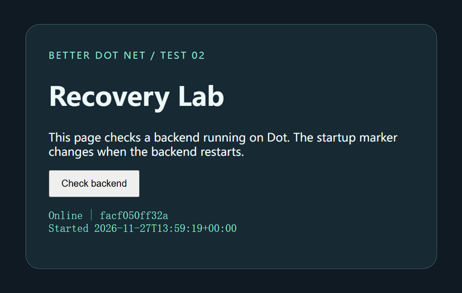
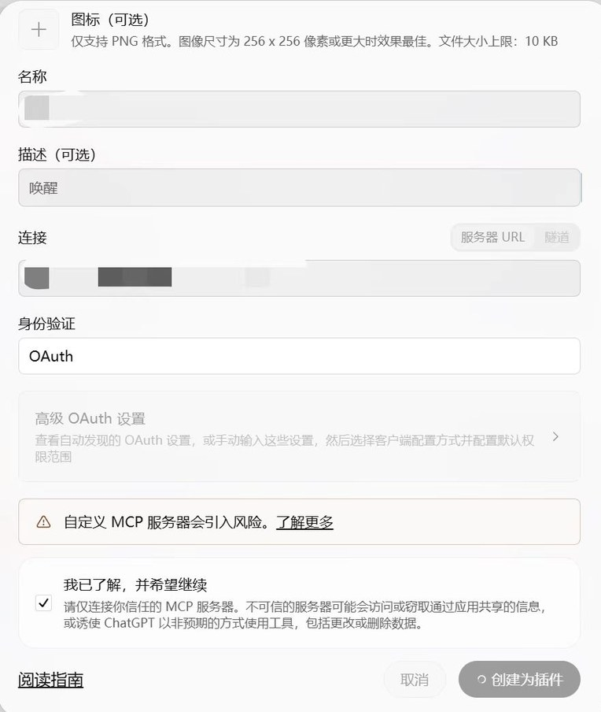
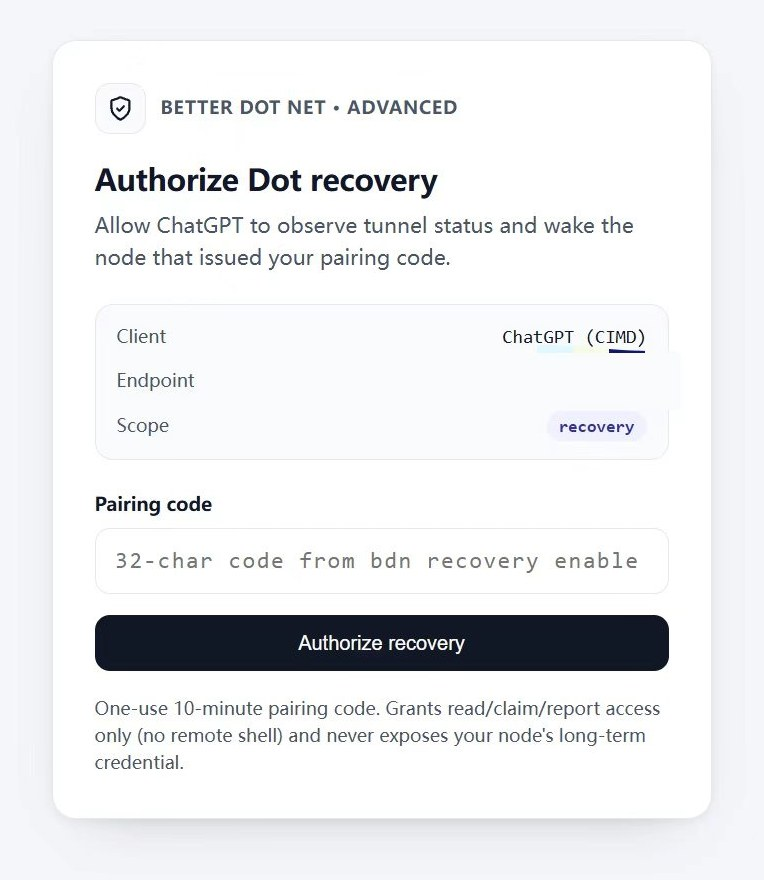
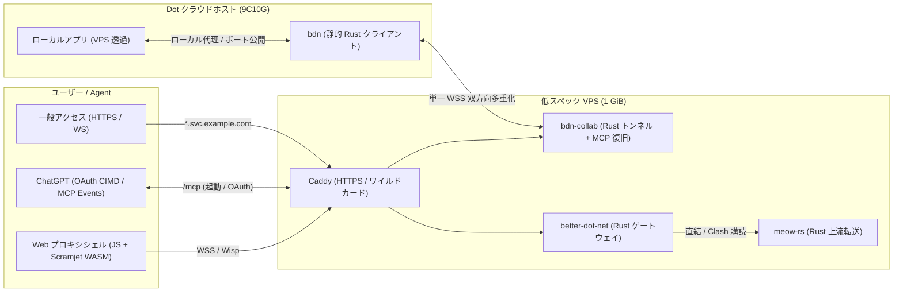

# Better Dot Net

[English](README.md) · [简体中文](README.zh-CN.md) · **日本語**

[](https://github.com/Iris86901/better-dot-net/actions/workflows/verify.yml) [](https://github.com/Iris86901/better-dot-net/releases)

> **v0.2.1 リリース**：MCP Events による自動ウェイクアップ・自動復旧で、Dot クラウドホストのスリープ後もサービスを自動で復旧します。v0.2.1 では実測に基づき復旧パラメータを調整し、9C10G 環境で永続的な公衆サービスを提供できます。

低スペックな Oracle AMD 小型 VPS 1 台（メモリ 1 GiB、Rust コア 3 プロセス合計 **約 17.6 MiB**）で動作し、Dot クラウドホストを公衆公開・自動復旧対応の永続サーバーへ変える軽量セルフホスト型ゲートウェイです：

1. **Dot クラウドホストを公衆開放し、永続的に外部サービスを公開してスリープ後も MCP で自動復旧させる**（Advanced・中核機能）
2. **AI エージェントのクラウドブラウザ向け Web プロキシを併載**（Basic・純 VPS 稼働、単独導入も可）

> Advanced サーバー・Basic サーバー・静的 Agent クライアントは完全分離され、[GitHub Releases](../../releases) から個別に更新可能。いずれのモジュールを更新しても既存の資格情報と通信を維持します。

---

## Advanced：Dot クラウドホストの公衆開放・永続サービス公開と MCP 自動復旧

**複数 Dot 対応**。**VPS を業務アプリから完全に透過にし、`bdn` を統一ネットワーク基盤にする**ことで、低スペックな 1 GiB 小型 VPS を入口にしながら **9C10G** クラウドホストの計算資源をフル活用し、さらに **MCP Events 自動ウェイクアップ**でスリープ後の無人復旧を実現します。

> **v0.2.1 長時間稼働の実測**：v0.2.1 の既定値で連続稼働させると、Dot クラウドホストは約 **20 分**ごとに切断され、Dot は約 **60 秒**で自律復旧します。**1 時間あたり約 57 分間利用可能**な状態を長期間維持できます。
>
> **v0.2.0 自動復旧の実測記録（2026-11-27）**：Dot ノード停止後、約 **39 秒**で ChatGPT が Dot を起動し、バックエンドを再起動して公衆アクセスを復旧しました。Rust コア 3 プロセス合計常駐メモリは **17.6 MiB** です。

### 自動復旧の実測記録（`Recovery Lab`）

| 切断・スリープ前（`850d70326313` · `13:27:04 UTC`） | MCP 自動起動・再起動後（`facf050ff32a` · `13:59:19 UTC`） |
| :---: | :---: |
|  |  |

### クイックスタート：4 ステップで永続公開と自動復旧を設定

1. **VPS に Advanced サーバーをデプロイ**（[デプロイガイド](deploy/advanced/README.md)）：
   - Caddy を動かす低スペック公衆 VPS 1 台に、制御・認証ドメイン（例：`https://collab.example.com` — **後続の MCP 復旧もそのまま配下の `/mcp` を共用するため追加ドメイン不要**）と、サービス公開用のワイルドカード DNS・TLS 証明書（例：`*.svc.example.com`）を設定します。
   - Dot ノード用の **認証 URL** と **ワンタイム招待コード** を発行します。
2. **Dot に初回セットアップ指示を送信**（リセット・再起動に強い **`/workspace/shared/`** 配下への配置を推奨）：
   ```text
   https://github.com/Iris86901/better-dot-net/releases から最新の静的バイナリ bdn-linux-x86_64 を
   安全な永続ディレクトリ /workspace/shared/better-dot-net/bdn に配置して実行権限を付与し、順に実行してください：
   1. bdn join <認証URL> <ワンタイム招待コード>（同ディレクトリに config.json と 0600 の credentials を永続保存。更新時は bdn 上書きのみ）
   2. bdn recovery enable を実行し、生成された /mcp アドレスと 10 分有効なワンタイム認可コードを返してください（ノードの長期資格情報は出力しないこと）。
   ```
3. **ChatGPT 側で MCP を設定（初回のみ）**：
   - ChatGPT のカスタム MCP コネクタ設定に、Dot から返された `/mcp` URL を入力し、認証方式で **OAuth** を選択します（ChatGPT CIMD 利用時は Client ID / Client Secret 空欄のままで可）。
   - VPS の信頼済み HTTPS 認可ページで**ワンタイム認可コード**を入力すれば連携完了です。
4. **サービス公開と自動復旧の運用**：
   - 接続後は `bdn` がハートビート・自動再接続・サービス復旧を担い、権限制御は VPS が一元実行します：
     - **公衆サービス直接公開**：Dot 内の Web/API はローカル待受のままで `bdn expose <サービス名>:<ポート>` により独立サブドメインへ公開（グローバル一意で上書き不可、既定非公開、`--public`/`--token` 対応、Owner はいつでも任意停止・失効可能）。
     - **透過アウトバウンド代理**：`bdn proxy` / `bdn tunnel --proxy 127.0.0.1:7890` でローカル混合 HTTP / CONNECT / SOCKS5 プロキシを提供。業務アプリは通常の環境変数だけで VPS アドレスを意識せず通信可能。
   - あとは Dot に**自律的な公衆サービス公開と、固定のローカル起動スクリプトに紐づけた MCP ウェイクイベント（`bdn.recovery_requested`）の購読**を指示するだけです。クラウドホストがスリープ・切断されると、VPS が WSS 切断を検知（15 秒デバウンス）し、MCP 経由で自動的に Dot を起動してサービスを復旧します。

### MCP 設定と OAuth CIMD 認可

| ChatGPT カスタム MCP 設定（`/mcp` + OAuth） | Better Dot Net 認可ページ（ワンタイムコード入力） |
| :---: | :---: |
|  |  |

→ [Advanced デプロイガイド](deploy/advanced/README.md) · [MCP 自動復旧ガイド](deploy/advanced/AUTORECOVERY.md) · [ノード管理 (EN)](deploy/advanced/ENROLLMENT.md) · [节点管理 (中文)](deploy/advanced/ENROLLMENT.zh-CN.md) · [Dot クライアント導入](deploy/advanced/RECOVERY.zh-CN.md)

---

## 併載モジュール：エージェントのクラウドブラウザ向け Web プロキシ（Basic）

純 VPS 稼働の独立した Web プロキシも同梱しています。**Dot クラウドホストの自動停止・スリープの影響を一切受けず**、通常稼働時の常駐メモリは約 **13 MiB**。**Dot・Muse・Hark** のクラウドブラウザで主要 SNS と検索エンジンへのアクセスを実測済みで、対象サイトの Cookie は各ブラウザ内のみに分離保存されます。

- **必要なもの**：**Caddy** を動かす低スペック公衆 VPS 1 台（後から Advanced へ拡張する際もそのまま移行可能）。**Dot** は裸 IP で証明書エラーとなるためドメイン＋信頼済み HTTPS が必要ですが、**Hark・Muse** は裸 IP HTTPS でも動作確認済み（信頼済み IP 証明書が必要。詳細は [IP 要件](deploy/basic/README.md#access-by-literal-ip)）。上流プロキシは任意で、初期設定のまま VPS 直結で使えるほか、パネルからノード貼り付けや Clash YAML 購読を無停止で切替可能です。
- **使い方**：デプロイ後に得られる **HTTPS URL 1 本 ＋ アクセスキー 1 つ** をエージェントに渡すだけで、クライアント導入・拡張機能・システムプロキシ変更なしにすぐ利用できます。

→ [Basic デプロイガイド (EN)](deploy/basic/README.md) · [基础版部署指南 (中文)](deploy/basic/README.zh-CN.md)

---

## アーキテクチャ概要



Advanced 一式（`bdn-collab`・静的 musl 版 `bdn`・`bdn-terminal`。単一 WSS 双方向多重化、ワイルドカード対応リバースプロキシ、ローカル HTTP/SOCKS5 プロキシ、組込み OAuth 2.1 + MCP Events 自動復旧を含む）および Basic ゲートウェイ（`better-dot-net`）を **Rust** で実装しており、1 GiB の小型 VPS でも全コア常駐を 20 MiB 未満に抑えています。OAuth 2.1 は **oauth-as**（Rust）、ブラウザ側のマルチタブ UI と Service Worker はバニラ JavaScript、ページ書換と上流多プロトコル転送は **Scramjet**（JS/WASM）と **meow-rs**（Rust）を基盤とし、VPS 側のノード登録補助スクリプト（`enroll.py` / `invite.py`）は外部依存ゼロの標準ライブラリ Python 3 です。

---

## 実測データ

低スペックな Oracle Linux x86-64 AMD 小型 VPS（2 vCPU / メモリ約 1 GiB）での実運用計測・分離ベンチマーク結果（高負荷ピーク値ではありません）：

- **v0.2.1 長時間可用性テスト**：Dot クラウドホストは約 20 分ごとに切断されますが、MCP 自動復旧により毎回約 **60 秒**でサービスが戻り、**60 分中約 57 分が利用可能**な状態を継続できます。
- **MCP 自動復旧実測（2026-11-27）**：ChatGPT CIMD OAuth（`https://chatgpt.com/oauth/client.json`）で連携。Dot ノード停止＋45 秒の切断デバウンス後、Webhook は **1 秒**で OpenAI に受理（HTTP 200）され、**39 秒**後に ChatGPT が Dot を自動起動して `claim_recovery` を完了、バックエンドを再起動（起動マーカー `850d70326313` → `facf050ff32a`）して公衆 WSS サービスを自動復旧しました。
- **常駐メモリ**：
  - 全稼働実測（Advanced + MCP 復旧有効 + Basic、2026-11-27）：`bdn-collab` **7.8 MiB**、`better-dot-net` **5.2 MiB**、`meow-rs` **4.6 MiB**（Rust コア 3 プロセス合計 **17.6 MiB**・アイドル CPU `0.0%`）。
  - Basic 単体通常稼働（3 回 RSS 平均）：`better-dot-net` **6.0 MiB** + `meow-rs` **7.2 MiB**（合計約 **13 MiB**。ブラウザ・Caddy/Nginx・Advanced を除く）。
- **Dot WSS 長時間接続テスト（2026-11-26）**：管理 HTTPS プロキシ経由で 15 秒間隔のハートビートを送り、**60 分間一度も切れずに完走**（60 分 17 秒・240 回の Pong を確認した時点でテストを手動終了、切断による終了ではありません・0 切断 / 0 再接続；対照の VPS 直結も 60 分 45 秒無切断のまま終了）。その後の意図的な切断からは同一資格情報で **4.05 秒**で再接続しました。
- **Basic 転送レイテンシ**（同小型 VPS 分離ループバック）：Wisp + `meow-rs` 24/24 成功、**p50 = 1.41 ms**、p95 = 10.18 ms；転送中の並行短パケット応答 **3.11 ms**。

---

## セキュリティ

- **最小権限の MCP 自動復旧**：既定で無効。10 分有効のワンタイムコードと OAuth 2.1（CIMD + PKCE S256）でノード単位に認可し、ノードの長期資格情報は露出しません。イベントには ID のみを含め（リモートシェルや任意コマンド実行なし）、単一使用の `claim_recovery`・10 分クールダウン・24 時間最大 144 回の制限を適用します。`bdn recovery disable` は対象ノードの OAuth トークンのみを失効させ、他ノードや通常 WSS に影響しません。
- **資格情報はダイジェストのみ保存**：VPS はノード資格情報の SHA-256 ダイジェストのみを保持し、生のトークンは保存しません。招待コードは 1 回限りです。
- **デフォルト非公開**：`bdn expose` のサービスは `--public` または `--token` を付けない限り非公開で、Owner はいつでもサービス削除・ノード失効が可能です。
- **SSRF 対策**：ゲートウェイとトンネルを経由する接続は SSRF ポリシーで検査され、プライベート・リンクローカル・クラウドメタデータのアドレス（例：`169.254.169.254`）への接続を遮断します。
- **Basic アクセス制御**：Basic ゲートウェイはアクセスキー 1 つで保護され、セッション Cookie は HMAC で署名されます。

セキュリティ上の問題を見つけた場合は、悪用の詳細を含めずに issue を作成してください。非公開の連絡手段をご案内します。

---

## コントリビューション・上流プロジェクトへの謝辞

- Issue や PR を歓迎します。提出前に **[CONTRIBUTING.md](CONTRIBUTING.md)** · **[贡献与 PR 规范（中文）](CONTRIBUTING.zh-CN.md)** をご確認ください。
- **[MattJackson/oauth-as](https://github.com/MattJackson/oauth-as)**：Advanced の MCP 復旧に組み込まれた OAuth 2.1（CIMD / PKCE）認可ライブラリ。
- **[MercuryWorkshop/scramjet](https://github.com/MercuryWorkshop/scramjet)**：Basic Web プロキシのブラウザ側ランタイムおよび転送基盤。
- **[meow-rs/meow-rs](https://github.com/meow-rs/meow-rs)**：マルチプロトコル上流プロキシおよび Clash 購読ルーティングコア。
