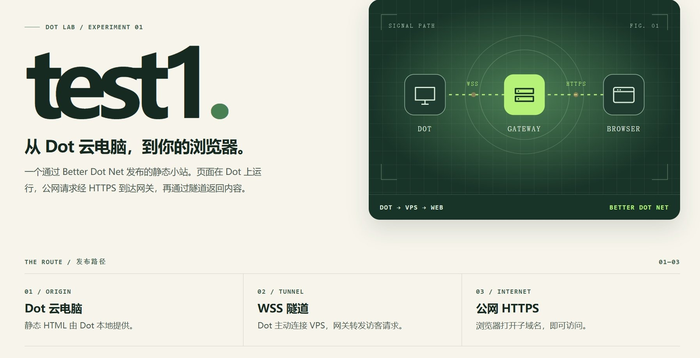
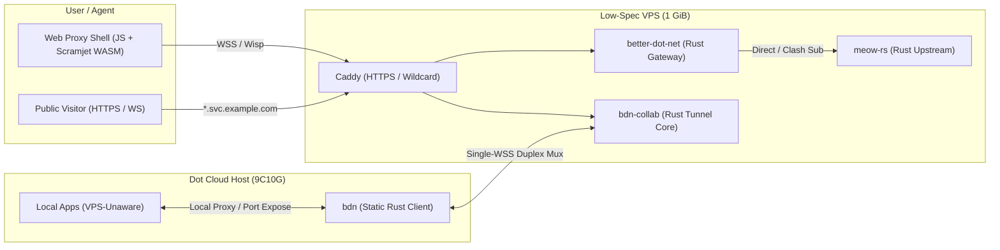

# Better Dot Net

**English** · [简体中文](README.zh-CN.md) · [日本語](README.ja.md)

**Runs effortlessly on a single low-spec Oracle AMD micro VPS (1 GiB RAM) at ~13 MiB resident memory** — built to solve two problems:

1. **Let any AI Agent's cloud browser access the open web through a proxy** (Basic)
2. **Let a Dot cloud host communicate externally and expose public services (currently still affected by cloud-host auto-shutdown)** (Advanced)

> Basic Server, Advanced Server, and the static Agent Client are completely decoupled and released independently on [GitHub Releases](../../releases). Upgrading any module preserves credentials and connectivity.

---

## Basic: Web Proxy That Hides Agent Environment Differences

Hosted purely on your VPS — **completely unaffected when a Dot cloud host sleeps or shuts down**. Verified on **Dot, Muse, and Hark** for accessing social platforms and search engines, with target-site cookies isolated locally in each browser.

### Quick Start: What You Need

1. **One low-spec VPS with a public IP** (a free-tier Oracle AMD 1 GiB instance is plenty): Use **Caddy** as the HTTPS edge (**if you may upgrade to Advanced later, start with Caddy on Basic to avoid painful reverse-proxy migrations**).
2. **A domain name (Dot only)**: Dot triggers a TLS certificate error on bare IPs—use a domain with a trusted HTTPS certificate. **Hark** and **Muse** work directly with bare-IP HTTPS deployments (still needs a browser-trusted IP certificate; see [literal IP guide](deploy/basic/README.md#access-by-literal-ip)).
3. **An upstream proxy (optional)**: Start with Direct VPS, then paste nodes or import a Clash YAML subscription from the web panel with zero-downtime hot switching.

### What You Get

- **One HTTPS URL + one Access Key**.
- Hand it to your Agent (or open it in any browser) for immediate web access—no client, no extension, no system proxy changes.

→ [Basic deployment guide (EN)](deploy/basic/README.md) · [基础版部署指南 (中文)](deploy/basic/README.zh-CN.md)

---

## Advanced: High-Speed Dot Cloud-Host Ingress/Egress & Service Publishing

Built for **Dot (multi-Dot supported)** with one goal: **keep the VPS invisible to application code, using `bdn` as unified network infrastructure** — use a tiny Oracle AMD micro VPS as your public edge while putting a **9C10G** Dot cloud host to full use.

### Quick Start: What You Need

1. **One low-spec public VPS running Caddy**: A dedicated control domain (e.g. `collab.example.com`), plus wildcard DNS & wildcard TLS (e.g. `*.svc.example.com`) if you want Dot to publish public subdomains.
2. **One or more Dot cloud hosts**.

### What You Get

- **One auth URL + one single-use invite code**.
- Give both to Dot: Dot downloads static `bdn-linux-x86_64` from [GitHub Releases](../../releases), places it inside **`/workspace`** to survive resets (e.g. `/workspace/shared/better-dot-net/bdn`), and runs `bdn join` once (`config.json` + `0600` `credentials` are saved beside `bdn`; upgrading is just overwriting `bdn`).
- Once joined, `bdn` handles heartbeats, auto-reconnect, and service recovery while the VPS enforces all permissions:
  - **Transparent outbound proxy**: `bdn proxy` / `bdn tunnel --proxy 127.0.0.1:7890` provides a local mixed HTTP / CONNECT / SOCKS5 proxy; apps only need standard proxy env vars and never know the VPS address.
  - **Direct public service publishing**: Apps inside Dot just listen on `localhost`—unaware they are public. Run `bdn expose <service>:<port>` to bind a globally unique wildcard subdomain (private by default, opt-in `--public` or `--token`; Owner can remove any service or revoke any node anytime).

> **Real-world status & known limitation**: Verified end-to-end with Dot autonomously deploying an app on its 9C10G cloud host and exposing it publicly. **The only known limitation is that Dot cloud hosts may auto-shutdown/sleep when idle** (services recover automatically upon reconnect; Basic runs purely on the VPS and is unaffected).

→ [Advanced deployment](deploy/advanced/README.md) · [Node enrollment (EN)](deploy/advanced/ENROLLMENT.md) · [节点管理 (中文)](deploy/advanced/ENROLLMENT.zh-CN.md) · [Dot client setup](deploy/advanced/RECOVERY.zh-CN.md)

---

## Architecture

The Basic gateway (`better-dot-net`) and the entire Advanced stack (`bdn-collab`, static musl `bdn`, `bdn-terminal`—including the single-WSS bidirectional stream mux, streaming wildcard reverse proxy, and local HTTP/SOCKS5 proxy) are written in **Rust**, keeping all resident server cores well under 20 MiB on a 1 GiB micro VPS. The multi-tab browser UI and Service Worker are vanilla JavaScript, page rewriting and upstream multi-protocol routing build on upstream **Scramjet** (JS/WASM) and **meow-rs** (Rust), and the optional VPS operator helpers (`enroll.py` / `invite.py`) use zero-dependency stdlib Python 3.

---

## Measured Benchmarks

Point-in-time observations on a low-spec Oracle Linux x86-64 AMD micro VPS (2 vCPU / ~1 GiB RAM; not peak-load bounds):

- **Resident memory**:
  - Basic baseline (3 normal RSS snapshots): `better-dot-net` **6.0 MiB** + `meow-rs` **7.2 MiB** (**~13 MiB** combined, excluding browser, Caddy/Nginx, and Advanced).
  - Full live stack (Basic + Advanced): `better-dot-net` **7.1 MiB**, `meow-rs` **4.9 MiB**, `bdn-collab` **5.2 MiB** (**17.2 MiB total** across all three Rust cores, `0.0%` idle CPU).
- **Relay latency** (isolated loopback benchmark on the same micro VPS): Wisp + `meow-rs` 24/24 succeeded, **p50 = 1.41 ms**, p95 = 10.18 ms; short echo during concurrent transfer **3.11 ms**.
- **Dot WSS long-lived connection test (2026-11-26)**: Dot connected to public WSS through its managed HTTPS egress proxy with 15 s heartbeats and **stayed up for a full 60 minutes without dropping** (240 matching Pongs over 60 min 17 s before we stopped the test manually—not a disconnect, 0 drops / 0 reconnects; the direct VPS control likewise stayed up for 60 min 45 s until stopped). After a deliberate close, reconnecting with the same credential took **4.05 s**.

---

## Contributing & Upstream Credits

- Issues and pull requests are welcome — please read **[CONTRIBUTING.md](CONTRIBUTING.md)** · **[贡献与 PR 规范（中文）](CONTRIBUTING.zh-CN.md)** first.
- **[MercuryWorkshop/scramjet](https://github.com/MercuryWorkshop/scramjet)**: Browser-side proxy runtime and transport foundation for Basic.
- **[meow-rs/meow-rs](https://github.com/meow-rs/meow-rs)**: Multi-protocol upstream egress and Clash subscription routing core.
