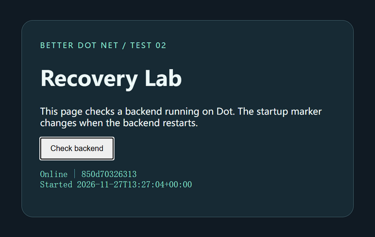
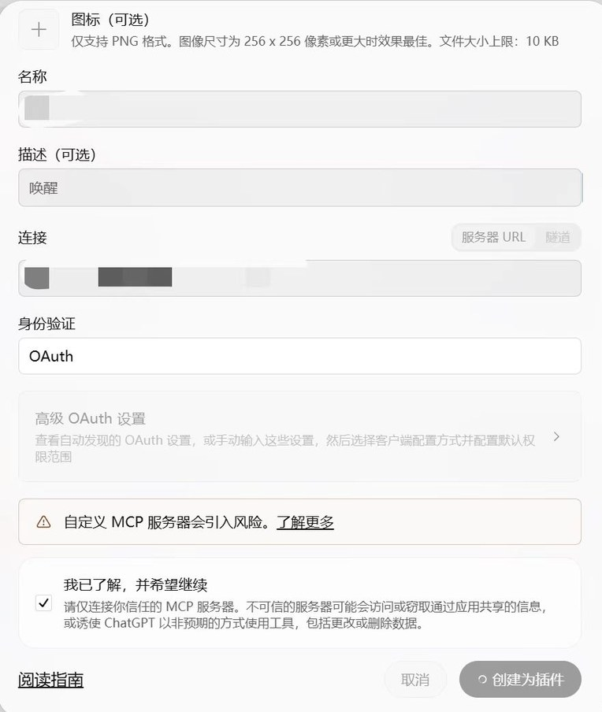
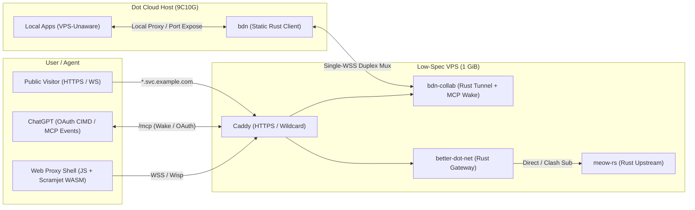

# Better Dot Net

**English** · [简体中文](README.zh-CN.md) · [日本語](README.ja.md)

[](https://github.com/Iris86901/better-dot-net/actions/workflows/verify.yml) [](https://github.com/Iris86901/better-dot-net/releases)

> **v0.2.0 is here**: Built-in MCP Events automatic wake & recovery solves Dot cloud-host idle sleep once and for all — your 9C10G cloud host can now serve persistent public applications around the clock.

A tiny self-hosted gateway that runs on a single low-spec Oracle AMD micro VPS (1 GiB RAM, **~17.6 MiB** combined RSS across all three Rust cores) and turns a Dot cloud host into a publicly reachable, self-healing backend:

1. **Expose Dot cloud hosts publicly, run persistent external services, and auto-recover after sleep via MCP** (Advanced, core capability)
2. **Includes a standalone web proxy for AI agent cloud browsers** (Basic, pure VPS, optional standalone deployment)

> Advanced Server, Basic Server, and the static Agent Client are completely decoupled and released independently on [GitHub Releases](../../releases). Upgrading any module preserves credentials and connectivity.

---

## Advanced: Public Exposure, Persistent Services & MCP Auto-Recovery for Dot

Built for **Dot (multi-Dot supported)** with one goal: **keep the VPS invisible to application code, using `bdn` as unified network infrastructure** — use a tiny 1 GiB micro VPS as your public edge while turning a **9C10G** Dot cloud host into a persistent, self-healing public server via **MCP Events auto-wake**.

> **v0.2.0 live recovery record (2026-11-27)**: Paired via ChatGPT CIMD OAuth (no manual Client ID / Secret). After stopping the Dot node and waiting the 45 s disconnect debounce, the wake webhook was acknowledged by OpenAI in **1 s** (HTTP 200), and **39 s** later ChatGPT automatically woke Dot, claimed recovery (`claim_recovery`), restarted the backend (startup marker changed `850d70326313` → `facf050ff32a`), and restored public access. With MCP wake active, all three Rust server cores totaled **17.6 MiB** RSS (`0.0%` idle CPU).

### Live Auto-Recovery Verification (`Recovery Lab`)

| Before Disconnect (`850d70326313` · `13:27:04 UTC`) | After Automatic MCP Wake & Restart (`facf050ff32a` · `13:59:19 UTC`) |
| :---: | :---: |
|  |  |

### Quick Start: 4 Steps to Persistent Services & Auto-Recovery

1. **Deploy the Advanced Server on your VPS** ([deployment guide](deploy/advanced/README.md)):
   - Prepare one low-spec public VPS running Caddy with one control/auth domain (e.g. `https://collab.example.com` — **MCP wake reuses `/mcp` on this same domain, so no second domain is needed**) plus wildcard DNS & TLS (e.g. `*.svc.example.com`) for public subdomains.
   - Issue an **auth URL** and a **single-use invite code** for your Dot node.
2. **Send one setup prompt to Dot** (we recommend **`/workspace/shared/`**, a safe persistent directory that survives Dot cloud-host resets):
   ```text
   Download the latest static bdn-linux-x86_64 binary from https://github.com/Iris86901/better-dot-net/releases
   into the safe persistent directory /workspace/shared/better-dot-net/bdn, make it executable, and run:
   1. bdn join <auth-url> <invite-code> (saves config.json and 0600 credentials beside bdn; future upgrades only overwrite bdn)
   2. bdn recovery enable — send me the generated /mcp URL and 10-minute one-use pairing code (do not print the node's long-term credential).
   ```
3. **Configure MCP in ChatGPT (one-time)**:
   - Open ChatGPT's custom MCP connector settings, paste the `/mcp` URL returned by Dot, and select **OAuth** (with ChatGPT CIMD you can leave Client ID and Client Secret blank).
   - On your VPS's trusted HTTPS authorization page, enter the **one-use pairing code** to complete pairing.
4. **Publish services & let auto-recovery run hands-free**:
   - Once joined, `bdn` maintains heartbeats, auto-reconnect, and service recovery while the VPS enforces all permissions:
     - **Direct public service publishing**: Apps inside Dot just listen on `localhost`—unaware they are public. Run `bdn expose <service>:<port>` to bind a globally unique subdomain (private by default, opt-in `--public` or `--token`; Owner can remove any service or revoke any node anytime).
     - **Transparent outbound proxy**: `bdn proxy` / `bdn tunnel --proxy 127.0.0.1:7890` provides a local mixed HTTP / CONNECT / SOCKS5 proxy; apps only need standard proxy env vars and never know the VPS address.
   - From then on, simply ask Dot to **autonomously deploy & publish public services while subscribing to MCP wake events (`bdn.recovery_requested`)** bound to its fixed local startup script. Whenever the cloud host sleeps or disconnects, the VPS detects the dropped WSS tunnel (15 s debounce) and automatically triggers MCP to wake Dot, restart the app, and restore public access.

### MCP Configuration & CIMD OAuth Authorization

| ChatGPT Custom MCP Setup (`/mcp` + OAuth) | Better Dot Net CIMD Authorize Page (One-Use Pairing Code) |
| :---: | :---: |
|  |  |

→ [Advanced deployment](deploy/advanced/README.md) · [MCP auto-recovery guide](deploy/advanced/AUTORECOVERY.md) · [Node enrollment (EN)](deploy/advanced/ENROLLMENT.md) · [节点管理 (中文)](deploy/advanced/ENROLLMENT.zh-CN.md) · [Dot client setup](deploy/advanced/RECOVERY.zh-CN.md)

---

## Included Companion: Web Proxy for Agent Cloud Browsers (Basic)

Better Dot Net also ships an independent Basic web proxy hosted purely on your VPS — **completely unaffected when a Dot cloud host sleeps or shuts down**, at ~**13 MiB** resident memory. Tested with the cloud browsers of **Dot, Muse, and Hark** on major social platforms and search engines, with target-site cookies isolated locally in each browser.

- **What you need**: One low-spec public VPS running **Caddy** (starting with Caddy makes adding Advanced and wildcard domains effortless later). **Dot** requires a domain with a trusted HTTPS certificate (bare IPs trigger a TLS error); **Hark** and **Muse** also work with bare-IP HTTPS deployments (requires a browser-trusted IP certificate; see [literal IP guide](deploy/basic/README.md#access-by-literal-ip)). An upstream proxy is optional — start with Direct VPS, or paste nodes / import a Clash YAML subscription from the web panel with zero-downtime hot switching.
- **How you use it**: You get **one HTTPS URL + one Access Key**. Hand it to your Agent (or open it in any browser) for immediate web access—no client, no extension, no system proxy changes.

→ [Basic deployment guide (EN)](deploy/basic/README.md) · [基础版部署指南 (中文)](deploy/basic/README.zh-CN.md)

---

## Architecture



The entire Advanced stack (`bdn-collab`, static musl `bdn`, `bdn-terminal`—including the single-WSS bidirectional stream mux, streaming wildcard reverse proxy, local HTTP/SOCKS5 proxy, and embedded OAuth 2.1 + MCP Events auto-recovery) and the Basic gateway (`better-dot-net`) are written in **Rust**, keeping all resident server cores well under 20 MiB on a 1 GiB micro VPS. OAuth 2.1 builds on **oauth-as** (Rust), the multi-tab browser UI and Service Worker are vanilla JavaScript, page rewriting and upstream multi-protocol routing build on **Scramjet** (JS/WASM) and **meow-rs** (Rust), and the optional VPS operator helpers (`enroll.py` / `invite.py`) use zero-dependency stdlib Python 3.

---

## Measured Benchmarks

Point-in-time observations on a low-spec Oracle Linux x86-64 AMD micro VPS (2 vCPU / ~1 GiB RAM; not peak-load bounds):

- **Live MCP auto-recovery test (2026-11-27)**: Paired via ChatGPT CIMD OAuth (`https://chatgpt.com/oauth/client.json`). After stopping the Dot node and waiting the 45 s disconnect debounce, the recovery webhook was acknowledged in **1 s** (HTTP 200); ChatGPT woke Dot and claimed recovery in **39 s**, restarted the backend (startup marker changed `850d70326313` → `facf050ff32a`), reported success, and automatically restored the public WSS service.
- **Resident memory**:
  - Full live stack (Advanced + MCP Wake active + Basic, 2026-11-27): `bdn-collab` **7.8 MiB**, `better-dot-net` **5.2 MiB**, `meow-rs` **4.6 MiB** (**17.6 MiB total** across all three Rust cores, `0.0%` idle CPU).
  - Basic-only baseline (3 normal RSS snapshots): `better-dot-net` **6.0 MiB** + `meow-rs` **7.2 MiB** (**~13 MiB** combined, excluding browser, Caddy/Nginx, and Advanced).
- **Dot WSS long-lived connection test (2026-11-26)**: Dot connected to public WSS through its managed HTTPS egress proxy with 15 s heartbeats and **stayed up for a full 60 minutes without dropping** (240 matching Pongs over 60 min 17 s before we stopped the test manually—not a disconnect, 0 drops / 0 reconnects; the direct VPS control likewise stayed up for 60 min 45 s until stopped). After a deliberate close, reconnecting with the same credential took **4.05 s**.
- **Basic relay latency** (isolated loopback benchmark on the same micro VPS): Wisp + `meow-rs` 24/24 succeeded, **p50 = 1.41 ms**, p95 = 10.18 ms; short echo during concurrent transfer **3.11 ms**.

---

## Security

- **Least-privilege MCP recovery**: off by default; paired per node via a 10-minute one-use pairing code and OAuth 2.1 (CIMD + PKCE S256, never exposes the node's long-term credential). Recovery events carry IDs only (no remote shell or arbitrary commands), enforce single-use `claim_recovery` with a 10-minute cooldown and 144-claims/24h cap, and `bdn recovery disable` revokes only that node's OAuth tokens without disturbing other nodes or normal WSS tunnels.
- **Credentials stored as digests**: the VPS keeps only SHA-256 digests of node credentials, never the raw tokens; each invite code is single-use.
- **Private by default**: `bdn expose` services stay private unless you add `--public` or `--token`, and the Owner can remove any service or revoke any node at any time.
- **SSRF protection**: outbound connections through the gateway and tunnel are checked against an SSRF policy that blocks private, link-local, and cloud metadata addresses (e.g. `169.254.169.254`).
- **Basic access control**: the Basic gateway sits behind one Access Key, with HMAC-signed session cookies.

Found a security issue? Please open an issue without exploit details and we will arrange a private channel.

---

## Contributing & Upstream Credits

- Issues and pull requests are welcome — please read **[CONTRIBUTING.md](CONTRIBUTING.md)** · **[贡献与 PR 规范（中文）](CONTRIBUTING.zh-CN.md)** first.
- **[MattJackson/oauth-as](https://github.com/MattJackson/oauth-as)**: Embeddable OAuth 2.1 authorization server library powering Advanced MCP CIMD/PKCE authentication.
- **[MercuryWorkshop/scramjet](https://github.com/MercuryWorkshop/scramjet)**: Browser-side proxy runtime and transport foundation for Basic.
- **[meow-rs/meow-rs](https://github.com/meow-rs/meow-rs)**: Multi-protocol upstream egress and Clash subscription routing core.
