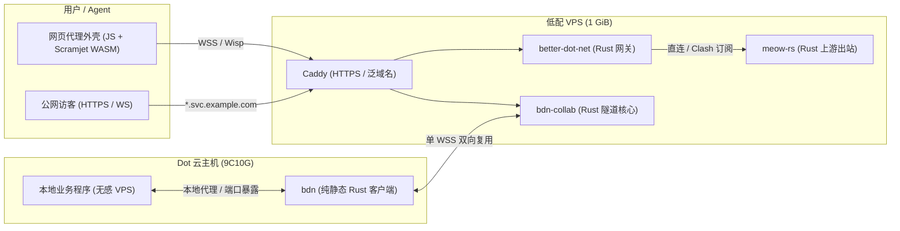

# Better Dot Net

[English](README.md) · **简体中文** · [日本語](README.ja.md)

**低配甲骨文 AMD 小鸡（1 GiB 内存）即可流畅运行，核心常驻仅 ~13 MiB** —— 解决两个问题：

1. **让 Agent 的云浏览器能够通过代理自由访问网站**（基础版）
2. **让 Dot 的云主机可以对外通信并提供公网服务（未完善，持续迭代中）**（进阶版）

> 基础版服务端、进阶版服务端、Agent 客户端三大模块完全解耦，均在 [GitHub Releases](../../releases) 独立发布与升级，升级任一模块均保留已有凭据与通信能力。

---

## 基础版：网页代理，屏蔽不同 Agent 环境差异

纯 VPS 托管，**完全不受 Dot 等云主机休眠或自动关机影响**。实测 **Dot、Muse、Hark** 均可直接访问主流社交平台与搜索引擎，目标站 Cookie 留在各自浏览器本地，多平台天然隔离。

### 快速入门：需要准备什么？

1. **一台有公网 IP 的低配 VPS**（一台低性能甲骨文 AMD 1 GiB 小鸡即绰绰有余）：推荐统一使用 **Caddy** 作为 HTTPS 入口（**如果后续有升级进阶版的计划，基础版务必使用 Caddy，否则后续接入进阶版与泛域名分发会比较麻烦**）。
2. **域名（仅 Dot 需要）**：实测 **Dot** 访问裸 IP 会触发证书错误，需要域名 + 可信 HTTPS 证书；**Hark、Muse** 实测可不配域名，直接裸 IP HTTPS 部署（需浏览器受信任的 IP 证书，见[裸 IP 说明](deploy/basic/README.zh-CN.md#access-by-literal-ip)）。
3. **上游代理（可选）**：默认 VPS 直连；需要切换出口时，可在网页面板粘贴节点或导入 Clash YAML 订阅，支持零中断热切换。

### 你会得到什么？

- **一个 HTTPS 网址 + 一个访问密钥（Access Key）**。
- 直接发给你的 Agent（或浏览器打开），无需装客户端、无需装扩展、无需改系统代理，即可自由访问网络。

→ [基础版部署指南（中文）](deploy/basic/README.zh-CN.md) · [Basic Deployment (EN)](deploy/basic/README.md)

---

## 进阶版：打通 Dot 云主机高性能出入口与公网服务发布

面向 **Dot（支持多台 Dot 独立接入）**，核心目标是 **VPS 对业务程序透明，`bdn` 作为统一网络基础设施**——只需一台低配甲骨文 AMD 小鸡作为公网出入口，即可充分释放 Dot **9C10G** 云主机的算力。

### 快速入门：需要准备什么？

1. **一台运行 Caddy 的低配公网 VPS**：预留独立控制域名（如 `collab.example.com`）；如需对外发布服务，再预配泛域名 DNS 与泛域名 TLS 证书（如 `*.svc.example.com`）。
2. **Dot 云主机**（支持多台独立接入）。

### 你会得到什么？

- **一个认证地址 + 一个一次性邀请码**。
- 发给你的 Dot 后，Dot 从本项目 [GitHub Releases](../../releases) 下载纯静态 `bdn-linux-x86_64` 客户端，**放入 `/workspace` 目录防止环境重置丢失**（例如 `/workspace/shared/better-dot-net/bdn`），执行一次 `bdn join` 即完成持久化认证（同目录生成 `config.json` 与 `0600` 的 `credentials`，后续升级只需直接覆盖 `bdn` 二进制）。
- 接入后即刻获得两项透明网络能力（心跳保活、断线自动重连、服务自动恢复全部由 `bdn` 维护，权限由 VPS 统一执行）：
  - **透明出站代理**：`bdn proxy` / `bdn tunnel --proxy 127.0.0.1:7890` 提供本地混合 HTTP / CONNECT / SOCKS5 代理，业务程序只需常规代理环境变量，无需知道 VPS 地址。
  - **自由对外发布服务**：Dot 内 Web/API 程序正常监听本地端口即可（无需感知公网），运行 `bdn expose <服务名>:<端口>` 即可通过独立子域名对外提供服务。子域名全局唯一防覆盖，默认私有，支持 `--public` 或 `--token`，Owner 可随时下线任意服务或撤销节点。

> **实测状态与已知限制**：已实测 Dot 自主在云主机部署应用并对外发布、公网直连可达，充分利用 9C10G 算力；**目前唯一已知限制是 Dot 云主机可能会在空闲时自动关机/休眠**（唤醒重连后服务自动恢复；基础版纯 VPS 运行，不受此影响）。

→ [进阶版部署指南](deploy/advanced/README.md) · [节点身份管理（中文）](deploy/advanced/ENROLLMENT.zh-CN.md) · [Dot 客户端接入与使用](deploy/advanced/RECOVERY.zh-CN.md)

---

## 架构概览

基础版网关（`better-dot-net`）以及进阶版整套服务端与静态客户端（`bdn-collab` / `bdn` / `bdn-terminal`，含单 WSS 双向多路复用、泛域名流式反代与本地 HTTP/SOCKS5 代理）均以 **Rust** 实现，因此能在 1 GiB 小机上保持极低常驻内存；前端多标签壳与 Service Worker 为原生 JavaScript，网页重写和上游多协议路由分别基于上游 **Scramjet**（JS/WASM）与 **meow-rs**（Rust），VPS 侧节点登记辅助脚本（`enroll.py` / `invite.py`）使用零依赖标准库 Python 3。

---

## 实测数据参考

以下为低配 Oracle Linux x86-64 AMD 小鸡（2 vCPU / ~1 GiB 内存）实际部署与隔离基准采样（非极端峰值）：

- **内存占用**：
  - 基础版常规采样（三次 RSS 均值）：`better-dot-net` **6.0 MiB** + `meow-rs` **7.2 MiB**，合计约 **13 MiB**（不含浏览器、Caddy/Nginx 与进阶版）。
  - 基础版 + 进阶版全套线上常驻实测：`better-dot-net` **7.1 MiB**、`meow-rs` **4.9 MiB**、`bdn-collab` **5.2 MiB**，三套 Rust 核心合计 **17.2 MiB**，空载 CPU `0.0%`。
- **转发延迟**（同款小机隔离回环基准）：Wisp + `meow-rs` 24/24 成功，**p50 = 1.41 ms**，p95 = 10.18 ms；并发传输中短包延迟 **3.11 ms**。
- **Dot WSS 长连接实测（2026-11-26）**：Dot 经平台 HTTPS 出口代理连至公网 WSS，每 15 秒一次心跳，**连续跑满 60 分钟全程未断线**（实测 60 分 17 秒、240 次匹配 Pong 后主动结束测试，并非断线，0 断线 / 0 重连；对照 VPS 直连同样跑满 60 分 45 秒未断后结束）；随后主动断开，使用原凭据 **4.05 秒**完成重连。

---

## 参与贡献与上游致谢

- 欢迎提交 Issue 与 PR，请先阅读 **[贡献与 PR 规范（中文）](CONTRIBUTING.zh-CN.md)** · **[Contributing (EN)](CONTRIBUTING.md)**。
- **[MercuryWorkshop/scramjet](https://github.com/MercuryWorkshop/scramjet)**：基础版网页代理的浏览器端运行时与传输基础。
- **[meow-rs/meow-rs](https://github.com/meow-rs/meow-rs)**：基础版多协议上游出站与 Clash 订阅路由核心。
