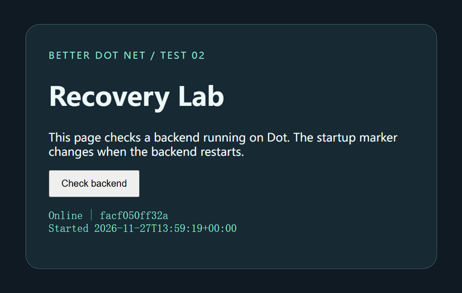
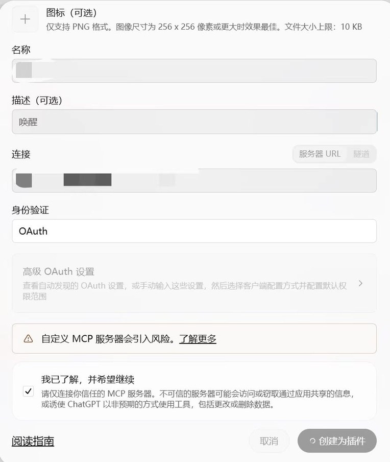
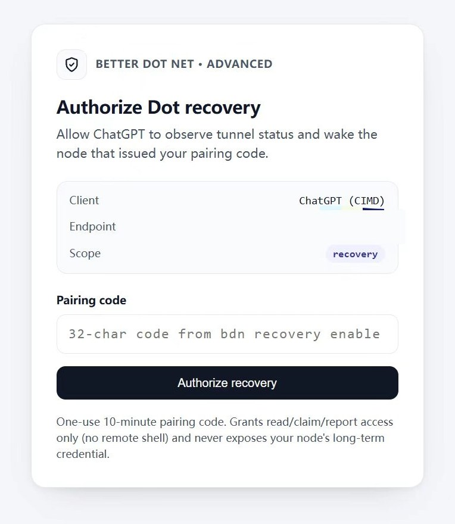
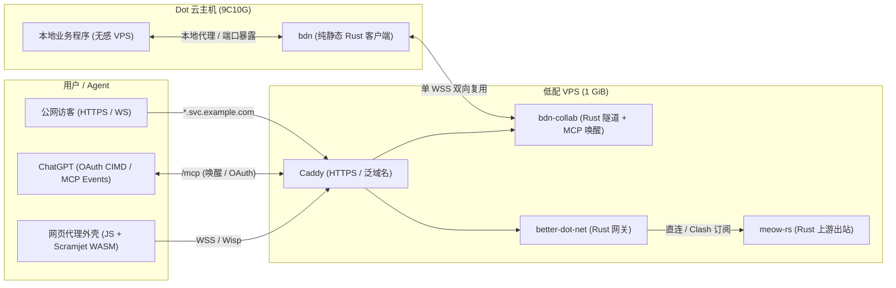

# Better Dot Net

[English](README.md) · **简体中文** · [日本語](README.ja.md)

[](https://github.com/Iris86901/better-dot-net/actions/workflows/verify.yml) [](https://github.com/Iris86901/better-dot-net/releases)

> **v0.2.0 正式发布**：新增基于 MCP Events 的自动唤醒与恢复能力，彻底解决 Dot 云主机空闲休眠导致服务中断的问题——你的 9C10G 云主机现在可以真正持久化对外提供公网服务了。

一个轻量的自托管网关。只需一台低配甲骨文 AMD 小鸡（1 GiB 内存，三核心全套常驻仅 ~17.6 MiB），就能把 Dot 云主机打造成可公网访问、休眠后自动恢复的持久化服务器：

1. **让 Dot 云主机公网开放、持久化对外提供服务，并在休眠后通过 MCP 自动唤醒恢复**（进阶版，核心能力）
2. **附带独立的 Agent 云浏览器网页代理**（基础版，纯 VPS 运行，可按需单独部署）

> 进阶版服务端、基础版服务端与静态 Agent 客户端完全解耦，均在 [GitHub Releases](../../releases) 独立发布与升级，升级任一模块均保留已有凭据与通信能力。

---

## 进阶版：Dot 云主机公网开放、持久化服务与 MCP 自动恢复

面向 **Dot（支持多台 Dot 独立接入）**，核心目标是让 **VPS 对业务程序完全透明，`bdn` 充当统一网络底座**——用一台低配 1 GiB 小鸡做公网入口，充分释放 Dot **9C10G** 云主机算力，并通过 **MCP Events 自动唤醒**实现休眠后的无人值守恢复。

> **v0.2.0 实测恢复记录（2026-11-27）**：使用 ChatGPT CIMD OAuth（无需手动配置 Client ID / Secret）。主动停止 Dot 节点并等待 45 秒断线防抖后，唤醒 Webhook **1 秒**送达 OpenAI（HTTP 200），**39 秒**后 ChatGPT 自动唤醒 Dot 完成认领（`claim_recovery`）、重启本地服务（启动标记由 `850d70326313` 更新为 `facf050ff32a`）并自动恢复公网访问；开启 MCP 唤醒后的全套三核心常驻内存合计仅 **17.6 MiB**（空载 CPU `0.0%`）。

### 自动恢复实测记录（`Recovery Lab`）

| 断线 / 休眠前（`850d70326313` · `13:27:04 UTC`） | MCP 自动唤醒重启后（`facf050ff32a` · `13:59:19 UTC`） |
| :---: | :---: |
|  |  |

### 快速入门：四步完成持久化接入与自动恢复

1. **在 VPS 部署进阶版服务端**（[进阶版部署指南](deploy/advanced/README.md)）：
   - 准备一台运行 Caddy 的低配公网 VPS，配置一个控制/认证域名（例如 `https://collab.example.com`，**后续 MCP 唤醒直接复用它下面的 `/mcp`，不需要第二个域名**），再配置用于对外发布服务的泛域名 DNS 与泛域名 TLS 证书（例如 `*.svc.example.com`）。
   - 为你的 Dot 节点签发**认证地址**与**一次性邀请码**。
2. **发给 Dot 一段接入指令**（推荐放到 **`/workspace/shared/`**，该目录在 Dot 云主机重启或环境重置后更安全，不易丢失）：
   ```text
   请从 https://github.com/Iris86901/better-dot-net/releases 下载最新的静态二进制 bdn-linux-x86_64，
   放到安全持久化目录 /workspace/shared/better-dot-net/bdn 并赋予可执行权限，然后依次执行：
   1. bdn join <认证地址> <一次性邀请码>（同目录会自动保存 config.json 与 0600 权限的 credentials，后续升级只需覆盖 bdn）
   2. bdn recovery enable，把生成的 /mcp 地址和 10 分钟一次性授权码发给我（不要输出节点长期凭据）。
   ```
3. **在 ChatGPT 中配置 MCP（只需配一次）**：
   - 打开 ChatGPT 自定义 MCP 连接器配置，填入 Dot 返回的 `/mcp` 地址，身份验证选择 **OAuth**（使用 ChatGPT CIMD 模式无需填写 Client ID 和 Client Secret）。
   - 跳转到你 VPS 的受信任 HTTPS 授权页后，填入**一次性授权码**并确认，即完成绑定。
4. **发布服务并开启自动恢复**：
   - 接入完成后，Dot 立即获得两项透明能力（心跳保活、断线重连与服务恢复由 `bdn` 自动维护，权限由 VPS 统一控制）：
     - **公网服务发布**：Dot 内 Web/API 正常监听本地端口即可，运行 `bdn expose <服务名>:<端口>` 即可通过独立子域名对外开放（全局唯一防覆盖，默认私有，支持 `--public` 或 `--token`，Owner 可随时下线任意服务或撤销节点）。
     - **透明出站代理**：`bdn proxy` / `bdn tunnel --proxy 127.0.0.1:7890` 提供本地混合 HTTP / CONNECT / SOCKS5 代理，业务程序只需常规代理环境变量，无需知道 VPS 地址。
   - 之后只需让 Dot **自主部署并发布公网服务，同时通过 MCP 订阅唤醒事件（`bdn.recovery_requested`）**并绑定固定的本地启动脚本。云主机空闲休眠或意外掉线时，VPS 会检测到 WSS 隧道断开（15 秒防抖）并自动触发 MCP 唤醒 Dot 重启服务、恢复公网访问。

### MCP 配置与 OAuth CIMD 授权

| ChatGPT 自定义 MCP 配置（填入 `/mcp` 并选 OAuth） | Better Dot Net 授权页（填入一次性授权码） |
| :---: | :---: |
|  |  |

→ [进阶版部署指南](deploy/advanced/README.md) · [MCP 自动恢复配置指南](deploy/advanced/AUTORECOVERY.md) · [节点身份管理（中文）](deploy/advanced/ENROLLMENT.zh-CN.md) · [Dot 客户端接入与使用](deploy/advanced/RECOVERY.zh-CN.md)

---

## 附带：面向 Agent 云浏览器的网页代理（基础版）

项目同时附带一套独立的基础版网页代理，纯 VPS 托管，**完全不受 Dot 云主机休眠或关机影响**，核心常驻仅约 **13 MiB**。已用 **Dot、Muse、Hark** 的云浏览器实测访问主流社交平台与搜索引擎，目标站 Cookie 留在各自浏览器本地，多平台天然隔离。

- **准备条件**：一台运行 **Caddy** 的低配公网 VPS（推荐直接用 Caddy，方便后续无缝启用进阶版与泛域名分发）；**Dot** 访问裸 IP 会触发证书错误，需要域名 + 可信 HTTPS 证书，**Hark / Muse** 可直接裸 IP HTTPS 部署（需浏览器受信任的 IP 证书，见[裸 IP 说明](deploy/basic/README.zh-CN.md#access-by-literal-ip)）；上游代理可选，默认 VPS 直连，也可在网页面板粘贴节点或导入 Clash YAML 订阅并零中断热切换。
- **使用方式**：部署后得到**一个 HTTPS 网址 + 一个访问密钥（Access Key）**，直接发给 Agent 或浏览器打开即可自由访问网络，无需装客户端、扩展或修改系统代理。

→ [基础版部署指南（中文）](deploy/basic/README.zh-CN.md) · [Basic Deployment (EN)](deploy/basic/README.md)

---

## 架构概览



进阶版整套服务端与静态客户端（`bdn-collab` / `bdn` / `bdn-terminal`，含单 WSS 双向多路复用、泛域名流式反代、本地 HTTP/SOCKS5 代理以及内嵌 OAuth 2.1 + MCP Events 自动恢复）以及基础版网关（`better-dot-net`）均以 **Rust** 实现，因此能在 1 GiB 小机上保持极低常驻内存；前端多标签壳与 Service Worker 为原生 JavaScript，OAuth 2.1 基于 **oauth-as**（Rust），网页重写与上游多协议路由分别基于 **Scramjet**（JS/WASM）与 **meow-rs**（Rust），VPS 侧节点登记辅助脚本（`enroll.py` / `invite.py`）使用零依赖标准库 Python 3。

---

## 实测数据参考

以下为低配 Oracle Linux x86-64 AMD 小鸡（2 vCPU / ~1 GiB 内存）实际部署与隔离基准采样（非极端峰值）：

- **MCP 自动唤醒恢复实测（2026-11-27）**：采用 ChatGPT CIMD OAuth（`https://chatgpt.com/oauth/client.json`）。主动停止 Dot 节点并等待 45 秒断线防抖后，唤醒 Webhook **1 秒**内送达 OpenAI（HTTP 200）；**39 秒**后 ChatGPT 自动唤醒 Dot 完成 `claim_recovery` 认领，Dot 重启本地服务（启动标记 `850d70326313` → `facf050ff32a`）、回报成功，并自动恢复公网 WSS 隧道与对外服务。
- **内存占用**：
  - 全套线上常驻实测（进阶版 + MCP 唤醒开启 + 基础版，2026-11-27）：`bdn-collab` **7.8 MiB**、`better-dot-net` **5.2 MiB**、`meow-rs` **4.6 MiB**，三套 Rust 核心合计 **17.6 MiB**，空载 CPU `0.0%`。
  - 仅基础版常规采样（三次 RSS 均值）：`better-dot-net` **6.0 MiB** + `meow-rs` **7.2 MiB**，合计约 **13 MiB**（不含浏览器、Caddy/Nginx 与进阶版）。
- **Dot WSS 长连接实测（2026-11-26）**：Dot 经平台 HTTPS 出口代理连至公网 WSS，每 15 秒一次心跳，**连续跑满 60 分钟全程未断线**（实测 60 分 17 秒、240 次匹配 Pong 后主动结束测试，并非断线，0 断线 / 0 重连；对照 VPS 直连同样跑满 60 分 45 秒未断后结束）；随后主动断开，使用原凭据 **4.05 秒**完成重连。
- **基础版转发延迟**（同款小机隔离回环基准）：Wisp + `meow-rs` 24/24 成功，**p50 = 1.41 ms**，p95 = 10.18 ms；并发传输中短包延迟 **3.11 ms**。

---

## 安全设计

- **最小权限 MCP 自动恢复**：默认关闭；按单节点通过 10 分钟一次性授权码 + OAuth 2.1（CIMD + PKCE S256）完成配对，绝不暴露节点长期凭据；唤醒事件仅传递 ID（无远程 Shell、不可下发任意命令），强制单次 `claim_recovery` 认领、10 分钟冷却与 24 小时最多 144 次上限；执行 `bdn recovery disable` 仅撤销该节点的 OAuth 令牌，不影响其他节点与正常 WSS 隧道。
- **凭据只存摘要**：VPS 只保存节点凭据的 SHA-256 摘要，不保存原始令牌；每个邀请码仅能使用一次。
- **默认私有**：`bdn expose` 发布的服务默认不公开，需显式加 `--public` 或 `--token`；Owner 可随时移除任意服务或撤销任意节点。
- **SSRF 防护**：经网关与隧道发出的连接都会经过 SSRF 策略检查，拦截内网、链路本地与云元数据地址（如 `169.254.169.254`）。
- **基础版访问控制**：基础版网关由一个访问密钥（Access Key）保护，会话 Cookie 经 HMAC 签名。

发现安全问题？请先提一个不含利用细节的 issue，我们会另行安排私下沟通渠道。

---

## 参与贡献与上游致谢

- 欢迎提交 Issue 与 PR，请先阅读 **[贡献与 PR 规范（中文）](CONTRIBUTING.zh-CN.md)** · **[Contributing (EN)](CONTRIBUTING.md)**。
- **[MattJackson/oauth-as](https://github.com/MattJackson/oauth-as)**：进阶版 MCP 唤醒内嵌的 OAuth 2.1（CIMD / PKCE）认证服务库。
- **[MercuryWorkshop/scramjet](https://github.com/MercuryWorkshop/scramjet)**：基础版网页代理的浏览器端运行时与传输基础。
- **[meow-rs/meow-rs](https://github.com/meow-rs/meow-rs)**：基础版多协议上游出站与 Clash 订阅路由核心。
